# Qual eixo para a defesa? Comparativo para o Felipe escolher

> **A escolha é sua.** Este documento não decide nada: ele coloca lado a lado as 5 opções de eixo que você mesmo levantou e a tese "o paciente é o animal, mas a clínica é construída com as pessoas que o amam", sempre com o seu material real.
>
> Tudo aqui vem do diário e das reflexões em `estagio/informacoes-do-estagio.md`. As interpretações clínicas estão **a confirmar** com a Cláudia ou o Thiago.

## O que o eixo decide e o que ele não muda

A estrutura já está decidida e não depende do eixo: **Parte 1, a clínica em geral, enxuta**, e depois **Parte 2, os casos que te interessaram**.

O eixo decide três coisas:
1. **O fio** que liga um caso ao outro na Parte 2, ou seja, por que esses casos e nessa ordem.
2. **A abertura e o fechamento:** o primeiro e o último minuto, que são o que a banca lembra.
3. **O que fica de fora:** um bom eixo também diz o que não precisa entrar.

Um eixo pode ser **combinado com a tese**. A tese vira o fio humano, e o eixo vira o fio de conteúdo. As combinações estão no fim.

---

## Quadro rápido

| | Em uma frase | Casos que mais encaixam | Abre com | Fecha com | Maior risco |
|---|---|---|---|---|---|
| **1. Tornar visível o oculto** | A clínica é a arte de ver o que não aparece por fora | Katita (raio-X), Bob (olhos tapados), Mel (ultrassom e biópsia), gato paraplégico (cristais), castração da gata (fetos mumificados) | O raio-X da Katita, antes, sem explicação | O que também não se vê: o que o tutor sente | Virar vitrine de exames, o que vai contra a decisão de que exames não viram caso |
| **2. Dar voz ao paciente que não fala** | O animal não diz onde dói; a clínica aprende a ouvir | Bob, Mel Serafina (mucosa branca), Katita mancando, gato paraplégico, filhotes | O teste do Bob: reage com os olhos livres, não reage com os olhos tapados | "Os animais têm uma alma muito pura." | Ficar sentimental; antropomorfizar |
| **3. Caráter formado por exposição e habituação** | Quem eu era no dia 1 e quem sou agora | Dia 1 (mortes e eutanásia), gato de rua, Katita, castração com auxílio, filhotes | 28/10: a morte apareceu três vezes | 19/11: o mesmo que tinha apatia por gatos diante de três filhotes vivos *(revisto em 21/11)* | Falar mais de você do que da clínica |
| **4. Mortalidade e tempo condensados em dados clínicos** | Cada caso é uma conta de tempo: anos, semanas, dias | Quimio aos 17 anos, Mel Serafina (3 dias de prazo), Mel (queda ao longo de semanas), eutanásia, fetos e filhotes | O par 17/11 → 19/11 | Os três filhotes vivos | Peso emocional; os exames voltarem pela porta dos fundos |
| **5. Mídia visual como argumento** | Mostrar em vez de descrever | Katita (animação e 3D), criocirurgia, linha do tempo, corpo do estágio | A Katita em modo cinema | O corpo do estágio inteiro aceso | É um método, não um tema; depende de internet |
| **Tese: as pessoas que o amam** | O paciente é o animal, mas a clínica é feita de gente | Golden (família presente), eutanásia, Atena (tutor), gato paraplégico (tutora), dobermann, Mel Serafina (donos), filhotes (resgate) | O golden morrendo no ultrassom, com a família na sala | Alguém resgatou a ninhada | Os casos técnicos ficarem em segundo plano |

---

## 1. Tornar visível o oculto

**A ideia:** quase tudo o que importa na clínica está escondido: dentro do osso, do baço, da bexiga, do útero, do sistema nervoso. A defesa mostra como a clínica torna isso visível e o que ainda fica sem resposta.

**Casos que encaixam**
- **Katita:** a fratura em Y só existe no raio-X. Antes e depois, com as peças aparecendo uma por uma.
- **Bob:** o raio-X mostra a fratura antiga, mas **não explica** a claudicação. O oculto era neurológico e apareceu com um teste simples, os olhos tapados.
- **Mel (labradora):** o baço com nódulos no ultrassom e a biópsia que deu o nome, hemangiossarcoma. Usar a **imagem** e o **laudo**, não a série de exames.
- **Gato paraplégico:** cristais na bexiga vistos no ultrassom.
- **Castração da gata (17/11):** fetos mumificados que ninguém sabia que estavam lá.

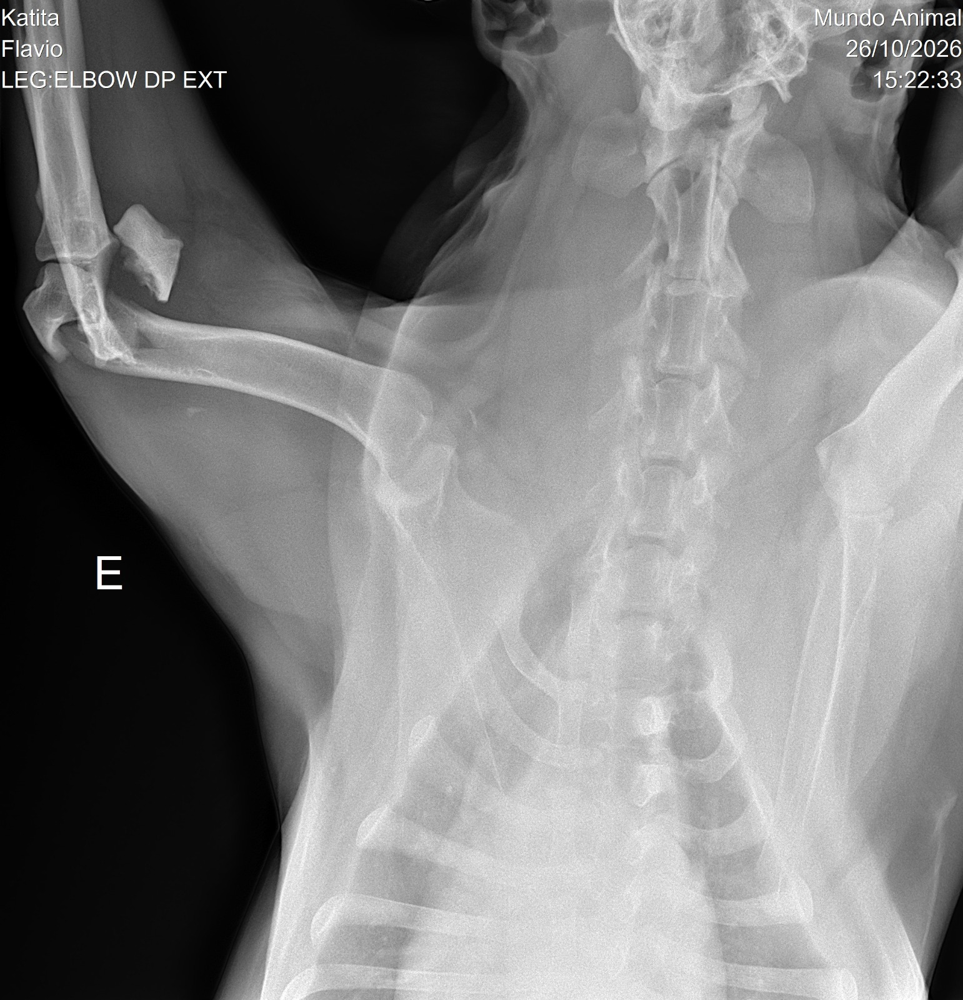 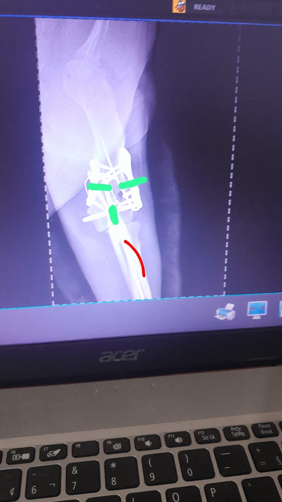 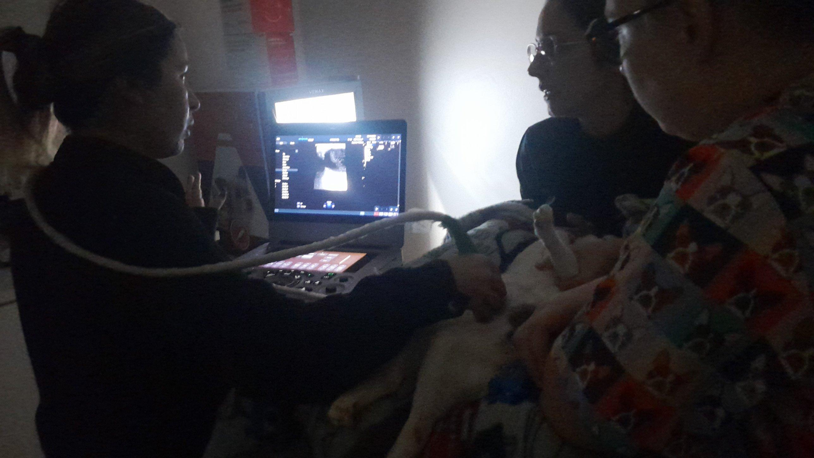

**Suas reflexões que sustentam:** a ideia de juntar os exames e "fazer algo visual com eles" (dia 01); o sucesso da animação da Katita com quem assistiu.

**Na Parte 1:** encaixa muito bem, porque raio-X, ultrassom, analisadores e microscópio são a infraestrutura que torna as coisas visíveis.

**Fica de fora:** criocirurgia, quimio e vacinas, que são procedimentos e não "revelações". Podem ir para atividades realizadas.

**Risco:** puxar para exames e imagens e contrariar a sua decisão de que exames não viram caso. Para evitar, cada caso precisa ter uma **pergunta clínica** que a imagem responde, e não só a imagem.

---

## 2. Dar voz ao paciente que não fala

**A ideia:** o animal não diz "dói aqui". A clínica precisa aprender a ouvir pelo corpo: o jeito de andar, a cor da mucosa, a reação a um toque. A defesa mostra os jeitos de "ouvir" que você viu.

**Casos que encaixam**
- **Bob:** a resposta veio de um teste de reflexo, não de uma frase.
- **Mel Serafina:** as mucosas muito brancas e a dificuldade de ficar de pé disseram "anemia" antes do hemograma.
- **Katita:** andar em três patas; o cotovelo falou pelo raio-X.
- **Gato paraplégico:** a tutora "ouve" a bexiga todos os dias e esvazia com as mãos.
- **Filhotes:** a respiração rápida e o cheiro da ferida do creme.

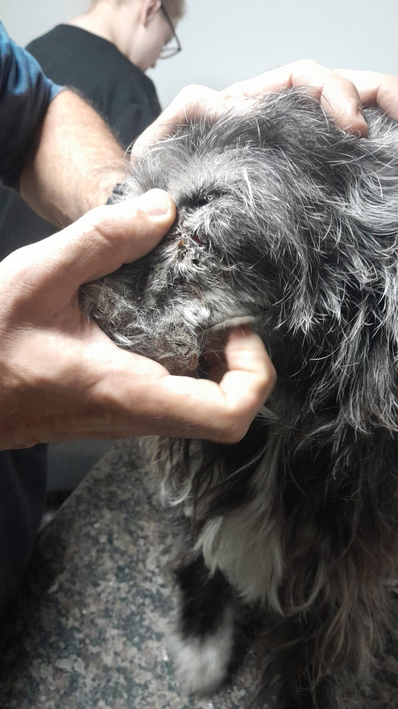 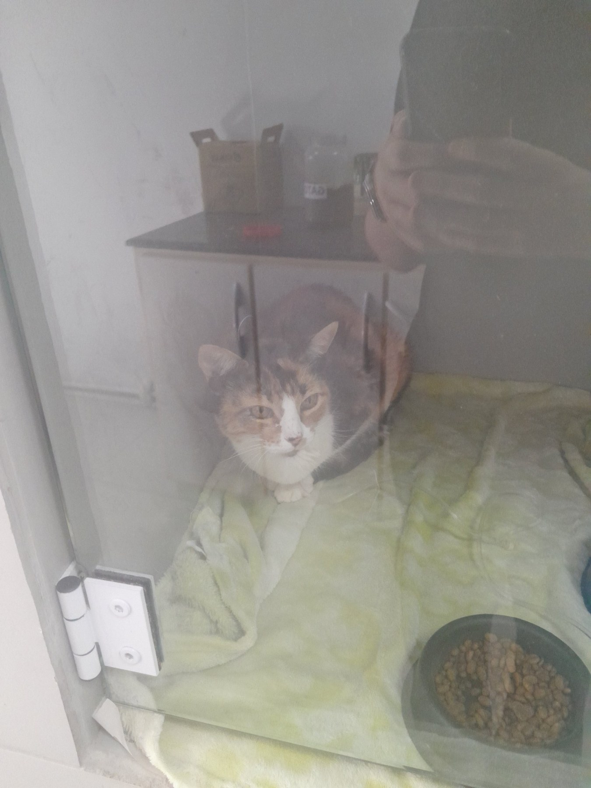 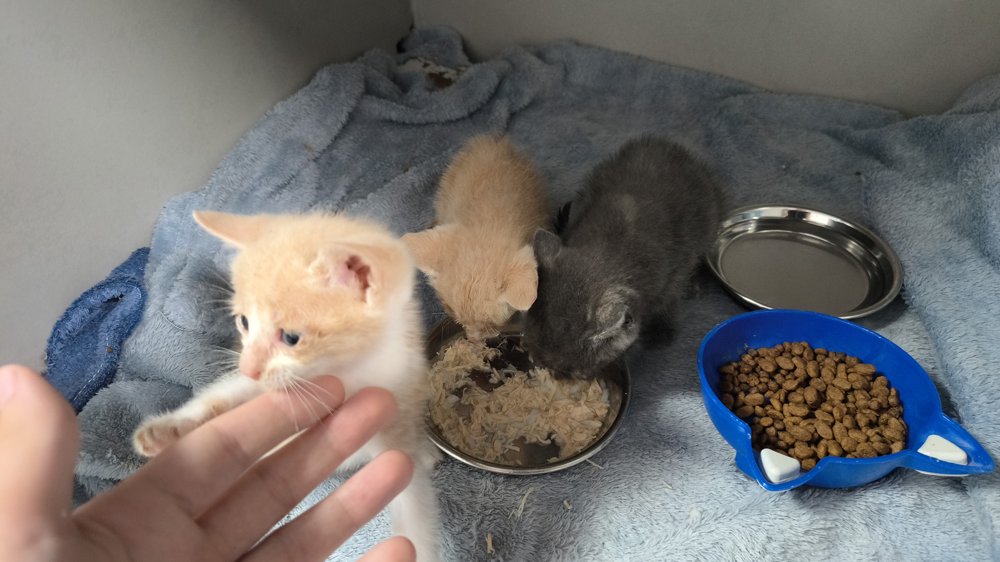

**Suas reflexões que sustentam:** "Os animais têm uma alma muito pura" (dia 02); o gato de rua que se esfregava nos seus dedos sob o vidro.

**Na Parte 1:** encaixa pouco. A estrutura da clínica não "ouve"; quem ouve é a equipe. Dá para ligar pelo consultório e pelo exame físico.

**Fica de fora:** quimio, criocirurgia, autoclaves.

**Risco:** soar sentimental ou atribuir ao animal o que é interpretação humana. Para evitar, cada "voz" precisa ser um **sinal clínico concreto**, com o nome técnico do sinal (a confirmar com a Cláudia).

---

## 3. Caráter formado por exposição e habituação

**A ideia:** o estágio como transformação. No dia 1 você chegou e já havia um animal morto; no mesmo dia viu outro morrer no ultrassom e acompanhou uma eutanásia com choro. Você tinha apatia por gatos. Três semanas depois, segurou um útero na castração e chegou ao dia dos filhotes. A defesa conta quem você era e quem ficou.

**Casos que encaixam, em ordem de data**
- **28/10:** pastora alemã morta, golden no ultrassom, eutanásia. O choque.
- **29/10:** o gato de rua e os dedos no vidro; pular o almoço pela cirurgia da Katita.
- **11/11:** a castração com a pinça na sua mão, como auxílio sob supervisão.
- **17/11 → 19/11:** os fetos e os filhotes.

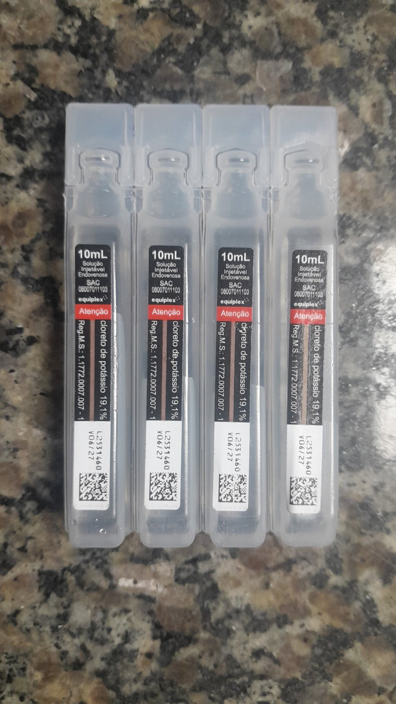 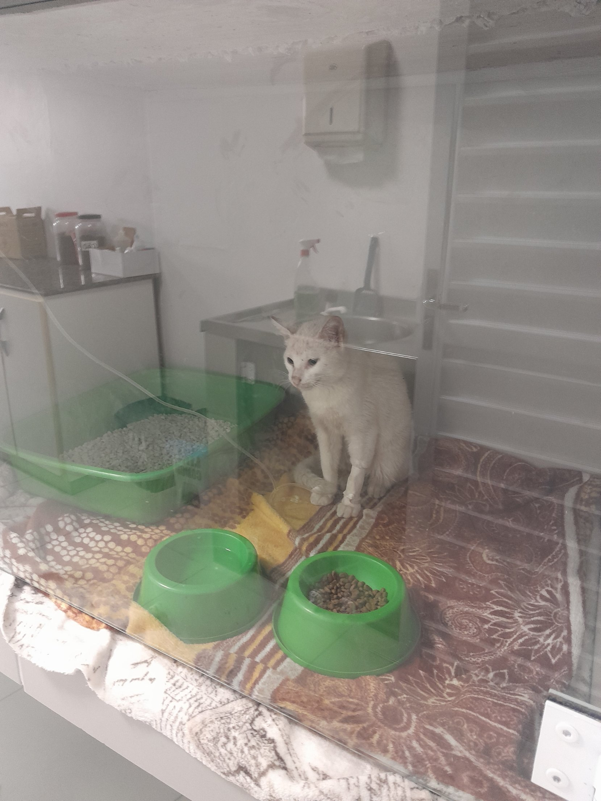 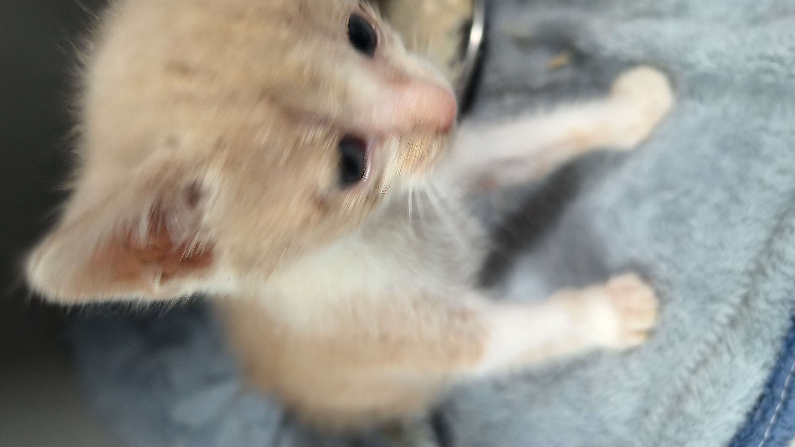

**Suas reflexões que sustentam:** quase todas. O veterinário trabalha com humanos, São Francisco, a alma pura, o estresse da rotina, a sua defesa como exploração da sua curiosidade.

**Na Parte 1:** encaixa como **cenário**: a clínica que você encontrou no dia 1.

**Fica de fora:** casos sem marca pessoal, como o melanoma e a quimio, a não ser que você tenha uma lembrança sua deles.

**Risco:** a banca é técnica e pode achar que falou mais de você do que da clínica. Para evitar, cada estação do arco precisa ter o **conteúdo técnico** do caso, e a parte pessoal fica numa frase.

---

## 4. Mortalidade e tempo condensados em dados clínicos

**A ideia:** na clínica, o tempo vira número: a idade, o prazo, a frequência do tratamento, a queda de um valor. A defesa mostra como a clínica lida com o tempo que resta e com o que chega cedo demais.

**Casos que encaixam**
- **Quimioterapia:** cão de 17 anos, uma sessão a cada 21 dias, há 7 meses.
- **Shih-tzu de 17 anos e 6 meses:** soro 3 vezes por semana.
- **Mel Serafina:** transfusão e um prazo de 3 dias.
- **Mel (labradora):** semanas entre o diagnóstico e o último exame. Usar o **tempo**, não a tabela de valores.
- **Eutanásia (dia 1):** a decisão de parar o tempo.
- **17/11 → 19/11:** três que nunca nasceram e três que chegaram vivos.

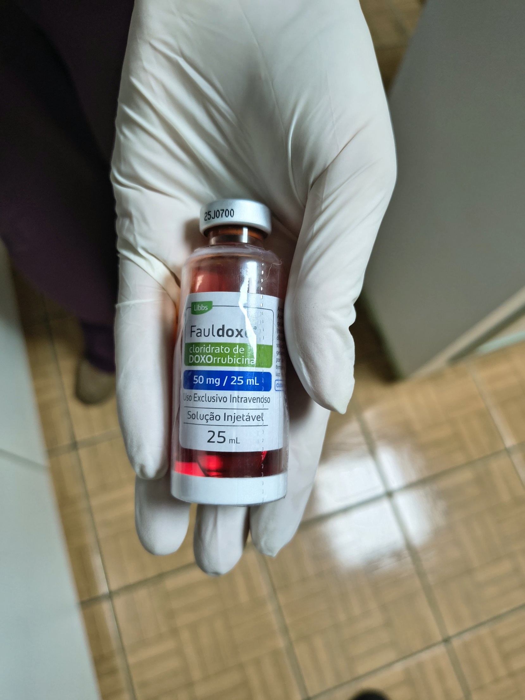 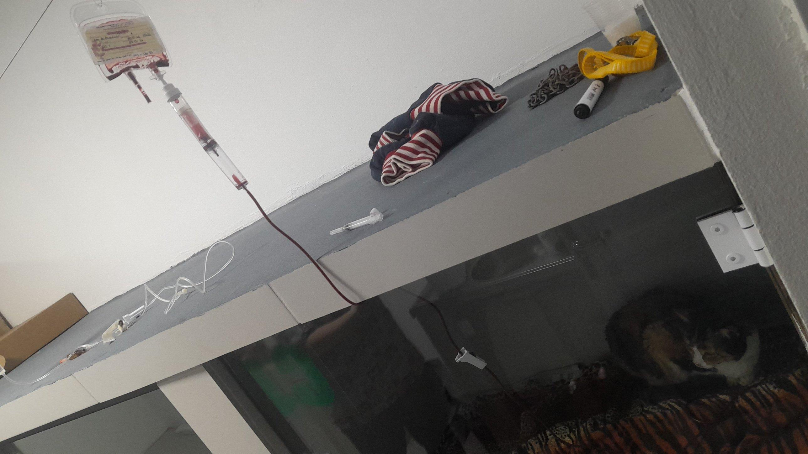 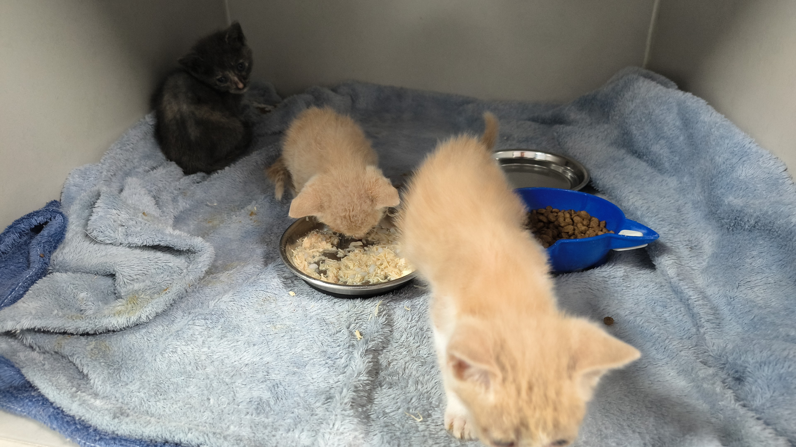

**Suas reflexões que sustentam:** o dia 1 inteiro; a reflexão de 19/11 sobre o sofrimento desnecessário no mundo.

**Na Parte 1:** encaixa pouco. Pode entrar pela rotina, com a frequência dos atendimentos e a cadeia de frio das vacinas.

**Fica de fora:** a ortopedia da Katita (o tempo dela é de recuperação, não de fim), a esporotricose e os procedimentos simples.

**Risco:** pesado demais para 25 minutos. Os exames voltam "pela porta dos fundos" como série temporal. Para evitar, use no máximo 3 casos de peso, sempre equilibrados com um que termina bem.

---

## 5. Mídia visual como argumento

**A ideia:** a forma da defesa é o argumento. Em vez de descrever a cirurgia, você mostra: animação, 3D, raio-X sobreposto, linha do tempo, corpo do estágio.

**Casos que encaixam:** os que têm material visual forte, como a Katita (animação 2D, 3D, modo cinema e raios-X), a criocirurgia (animações 2D e 3D) e a linha do tempo.

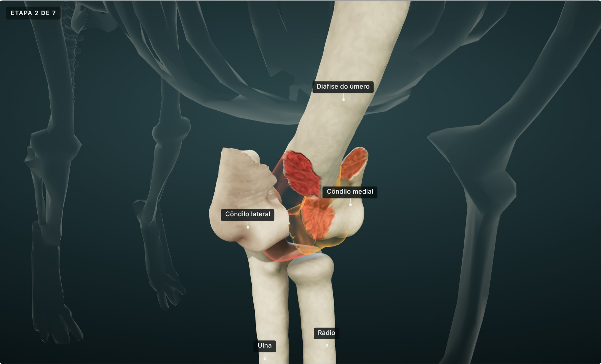 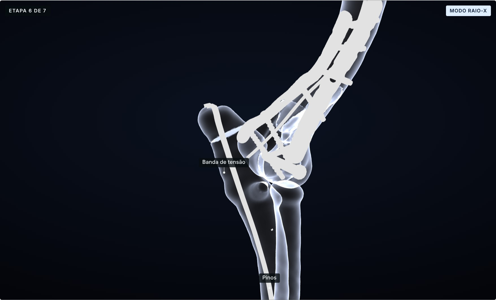 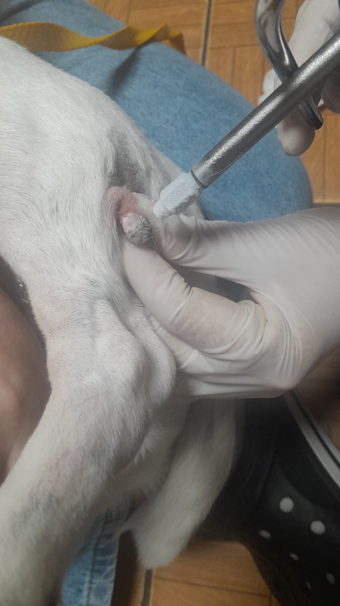

**Suas reflexões que sustentam:** o que mais agradou ao ortopedista foi a animação da Katita; "material real funciona, formas genéricas não".

**Na Parte 1:** encaixa bem, com a planta da clínica e os equipamentos mostrados de verdade.

**Fica de fora:** casos sem material visual bom.

**Risco:** é **um jeito de mostrar**, não um tema. Sozinho, deixa a pergunta "e daí?". Também depende de internet, então precisa do plano B offline. **Funciona melhor combinado** com outro eixo.

---

## A tese: "o paciente é o animal, mas a clínica é construída com as pessoas que o amam"

**A ideia:** em quase todo caso há uma pessoa decidindo, chorando, perguntando, recusando ou cuidando. A defesa mostra a clínica pelo lado humano.

**Casos que encaixam**
- **Golden:** morreu no ultrassom com a família presente.
- **Eutanásia:** a longa conversa com a dona, depois o choro.
- **Atena:** o tutor do fórum perguntando sobre comida, brinquedos e apartamento.
- **Gato paraplégico:** a tutora esvazia a bexiga dele todos os dias.
- **Dobermann:** a dona recusou a sedação e saiu alterada.
- **Mel Serafina:** os donos consideraram a eutanásia e escolheram tentar a transfusão.
- **Filhotes:** alguém resgatou a ninhada.

 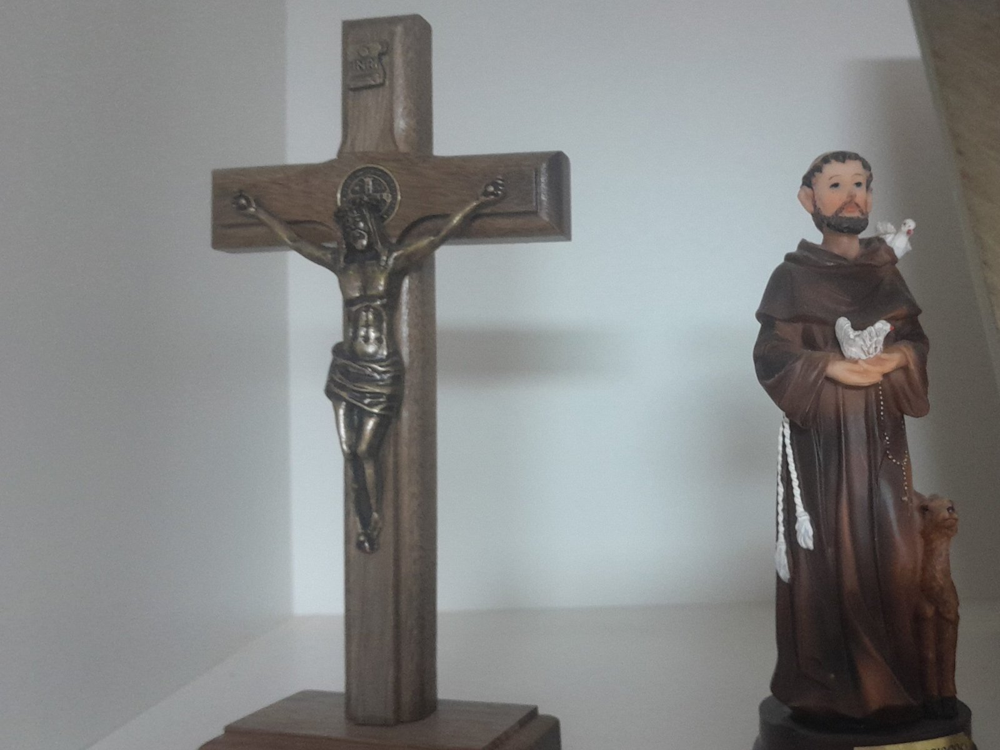 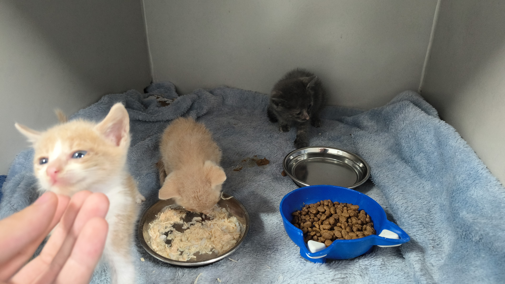

**Suas reflexões que sustentam:** a primeira de todas (dia 01): "o trabalho do veterinário é quase mais com humanos do que com animais", e São Francisco.

**Na Parte 1:** encaixa bem. A sala de espera, o balcão e o consultório são lugares de gente.

**Fica de fora:** casos sem tutor presente na sua memória, como o melanoma.

**Risco:** os casos técnicos ficarem em segundo plano. Para evitar, use a tese como **fio**, combinada com um eixo de conteúdo, e não como a defesa inteira.

---

## O par 17/11 → 19/11 em cada opção

| Opção | Como o par entra |
|---|---|
| 1. Oculto | Os fetos mumificados eram o oculto que ninguém via. Pode abrir ou fechar a parte de imagem e cirurgia |
| 2. Voz | Os filhotes "falam" pelo corpo: respiração, cheiro da ferida. Os fetos não tiveram voz |
| 3. Caráter | Fecha o arco: quem tinha apatia por gatos agora se importa com três |
| 4. Mortalidade | Encaixe natural, como abertura ou fechamento: três que não nasceram e três que chegaram vivos |
| 5. Mídia | Ninhada em silhuetas: 7, 4 apagadas, 3 acesas, e ao lado as 3 dos fetos |
| Tese | Alguém resgatou a ninhada; a diferença entre os dois trios foi uma pessoa |

## Combinações possíveis (eixo de conteúdo + fio humano)

- **3 + tese:** a sua transformação acontece **por causa** das pessoas da clínica e dos tutores. É a mais pessoal.
- **4 + tese:** o tempo e a morte, e quem fica do lado. É a mais forte emocionalmente e a mais arriscada.
- **1 + 5:** tornar visível o oculto, **mostrando**. É a mais técnica e visual e conversa com a Parte 1 de equipamentos.
- **2 + tese:** o animal que não fala e a pessoa que fala por ele. É a mais coerente entre si.

## Perguntas para ajudar você a escolher

1. **O que você quer que a banca lembre no dia seguinte:** um caso, uma imagem ou uma frase sua?
2. **Você fica confortável falando de você** por 25 minutos (eixo 3), ou prefere ficar atrás dos casos (eixos 1 e 2)?
3. **Quanto peso emocional cabe:** pouco (1 ou 5), médio (2 ou tese) ou muito (4)?
4. **Que caso você não quer deixar de fora de jeito nenhum?** O eixo certo é o que o acolhe sem forçar.

---

## Pontos encontrados na apresentação atual (para você decidir; nada foi alterado)

A apresentação `estagio/apresentacao/Defesa-de-Estagio-Felipe.pptx` foi montada antes das suas decisões de 19/11. Três pontos não combinam com elas:
- **Slide 14, "Mel: hemangiossarcoma no baço":** é um caso específico montado sobre exames. Pela decisão, os exames vão para atividades realizadas.
- **Slide 15, "Mel Serafina: anemia grave":** a transfusão foi decidida como atividade realizada, e não como caso.
- **Slide 23, "Referências bibliográficas":** você decidiu que citações não são necessárias, mas o **modelo do IFC tem esse slide**. Vale perguntar à Fran se ele é obrigatório.

Essas mudanças mexem na apresentação, então só acontecem com a sua aprovação.
