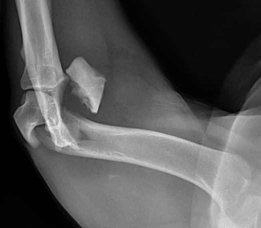
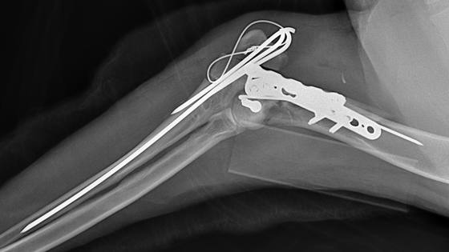

# Estágio em clínica veterinária: informações reunidas

Este documento junta tudo o que estava registrado nas páginas do projeto do estágio no Claude. Foram lidas por completo as 8 páginas abaixo. As páginas "Cachorro 3D" (só um visualizador de modelo 3D, sem dados do estágio) e "Irrigação e Drenagem" (outra disciplina) não entraram.

| Página | Assunto | Última atualização |
|---|---|---|
| [Cirurgia da Katita](https://claude.ai/artifact/Au4qBLBJmnheLzDqEfjwHu) | Animação em 2D, 7 etapas | 04/11/2026 |
| [Cirurgia da Katita em 3D](https://claude.ai/artifact/5jzyf4bCynjkN2e3FroFAk) | Cena 3D da sala cirúrgica, 7 etapas | 06/11/2026 |
| [Katita — modo cinema](https://claude.ai/artifact/GHahiDvJjzuTiSw8xbjt3c) | Vídeo animado de 44 s com legendas | 13/11/2026 |
| [Cirurgia da Katita · esqueleto](https://claude.ai/artifact/7T8s51Mbg1CVfJv3QmdYpF) | Esqueleto 3D (Sketchfab) e esquema, 6 etapas | 13/11/2026 |
| [Cirurgia da Katita no esqueleto 3D](https://claude.ai/artifact/HzsxC8rvK49Ss3tfd1b76K) | Versão mais completa, com radiografias reais | 15/11/2026 |
| [Criocirurgia do melanoma](https://claude.ai/artifact/S3VwYSQPFshNejM9JrGvDv) | Animação em 2D, 7 passos | 06/11/2026 |
| [Criocirurgia do melanoma em 3D](https://claude.ai/artifact/UMCerhq34d46XxXLvPbmq7) | Mesmo conteúdo em 3D | 06/11/2026 |
| [Microscópio do Estágio](https://claude.ai/artifact/85brKfCJS7kMSgTEgs4NYZ) | 6 hemogramas acompanhados | 06/11/2026 |

---

## 1. Local do estágio

- **Clínica:** Mundo Animal, em Sombrio (SC). O nome aparece em "Katita — modo cinema" ("cirurgia do cotovelo · Mundo Animal Sombrio") e no "Microscópio do Estágio" ("clínica Mundo Animal de Sombrio").
- **Laboratório externo citado:** Labvet Sul (laudo de hemograma da Mel, 07/10/2026).
- **Período com registros:** de 07/10/2026 a 06/11/2026 (datas dos exames e do caso da Mel).
- **Curso (pelo modelo de slides):** Técnico Integrado em Agropecuária, Instituto Federal Catarinense, campus Santa Rosa do Sul.

---

## 2. Caso Katita: cirurgia de fratura do cotovelo

### Paciente
- **Nome:** Katita
- **Espécie e raça:** cadela, SRD (sem raça definida)
- **Idade:** 7 anos
- **Peso:** 35 kg
- **Causa da lesão:** atropelamento

### Diagnóstico
- Fratura do **úmero distal do membro anterior esquerdo**, junto ao cotovelo.
- **Fratura em Y** (intercondilar), com o osso dividido em três partes: a diáfise (corpo do osso), o côndilo lateral e o côndilo medial.
- Os dois côndilos estavam afastados da articulação.
- Exame usado: **radiografia** do cotovelo esquerdo, projeção dorsopalmar (DP).

### Duração e equipe
- Cirurgia de **mais de 4 horas**.
- **Anestesista** acompanhando os sinais vitais no monitor durante toda a cirurgia ("garante a sobrevivência da Katita").
- **Cirurgião ortopedista** responsável pela fixação.

### Etapas da cirurgia
Esta é a sequência da versão mais completa ("no esqueleto 3D"), com estruturas, objetivo e instrumentos de cada etapa.

| # | Etapa | Estruturas | Objetivo | Instrumentos |
|---|---|---|---|---|
| 1 | O esqueleto e o cotovelo | Escápula, úmero, rádio, ulna e olécrano (membro anterior esquerdo) | Localizar a região operada | Nenhum |
| 2 | A lesão: fratura em Y | Diáfise do úmero, côndilos lateral e medial | Reconhecer a fratura em três partes | Radiografia |
| 3 | Acesso: osteotomia do olécrano | Olécrano, ulna proximal, tríceps braquial | Expor a articulação para enxergar e reduzir o úmero distal | Afastadores de Hohmann, serra oscilatória |
| 4 | Redução e parafuso transcondilar | Côndilos medial e lateral | Recompor a superfície articular e comprimir os fragmentos | Pinça de redução, furadeira ortopédica, parafuso de compressão |
| 5 | Placas e parafusos | Úmero distal e diáfise (faces lateral e medial), canal medular | Fixar os côndilos ao corpo do úmero com estabilidade | Placas ortopédicas, furadeira, parafusos corticais, pino intramedular |
| 6 | Banda de tensão e pinos | Olécrano, ulna, canal medular da ulna | Refixar o olécrano, transformando a tração do tríceps em compressão | Furadeira, pinos de Kirschner, fio de cerclagem |
| 7 | Fechamento | Músculo, tecido subcutâneo e pele | Reconstruir os planos de tecido e proteger a fixação | Porta-agulhas, fio absorvível e fio de nylon |

**Detalhe de cada etapa:**

1. **Na mesa de cirurgia.** Katita sob anestesia, com o membro preparado. A anestesista acompanha os sinais vitais no monitor.
2. **A lesão.** O úmero distal está fraturado em formato de Y. O côndilo lateral e o medial estão afastados da articulação.
3. **Osteotomia do olécrano.** O acesso à articulação era difícil. Afastadores mantêm os tecidos abertos. A serra oscilatória faz um corte transversal na base do olécrano (de lateral para medial). O olécrano é rebatido para cima, junto com a inserção do tríceps. Assim o cirurgião alcança o outro lado do cotovelo sem cortar mais osso.
4. **Redução e parafuso.** A pinça de redução recoloca os fragmentos até a superfície articular ficar contínua. A furadeira abre um túnel de lateral para medial. O parafuso atravessa e comprime os dois côndilos.
5. **Placas e pino.** Duas placas são apoiadas nas faces lateral e medial do úmero. Cada parafuso é precedido de perfuração e apertado até encostar na placa. Um pino intramedular entra pelo canal do úmero.
6. **Banda de tensão.** O olécrano volta à posição anatômica. Dois pinos longos entram pela ponta do olécrano e descem pela ulna. Um pino transversal na ulna ancora o fio de aço. O fio de cerclagem passa em formato de oito sobre os pinos.
7. **Fechamento.** Sutura do músculo com fio absorvível, ponto a ponto. Sutura da pele com fio de nylon.

### Implantes vistos na radiografia pós-operatória
Placas, parafusos, dois pinos longos na ulna e fio em oito (banda de tensão). Radiografias em projeção DP e lateral do cotovelo esquerdo.

### Radiografias

| Antes da cirurgia (DP) | Depois (DP) | Depois (lateral) |
|---|---|---|
|  |  |  |
| Um fragmento ósseo afastado da articulação | Placas, parafusos, pinos e fio | Pinos descendo pela ulna e fio em oito |

### Diferenças entre as versões
Vale conferir estes pontos com o que você viu na clínica antes da defesa:
- **Nome do parafuso:** as versões antigas dizem "parafuso **intercondilar**", a mais recente diz "**transcondilar**".
- **Pinos:** as versões antigas falam em "um pino fino" nas placas e "pino" na banda de tensão. A mais recente fala em pino intramedular no úmero, **dois pinos longos** na ulna e um pino transversal.
- **Anestesista:** aparece como "a anestesista" e como "o anestesista".

---

## 3. Caso: criocirurgia de melanoma em cão

O paciente não é identificado nas páginas (aparece só como "o cão", de pelagem clara).

| # | Passo | O que acontece | Por quê |
|---|---|---|---|
| 1 | O melanoma | Lesão escura e pequena na pele, em área tosada | Os melanócitos acumulam pigmento e formam o nódulo escuro |
| 2 | Nitrogênio líquido em spray | O veterinário borrifa nitrogênio líquido (cerca de −196 °C) sobre a lesão, que fica esbranquiçada | O gelo se forma dentro e fora das células, rompe as membranas e fecha os vasos que alimentam o tumor. Sem irrigação, o tecido morre |
| 3 | Inchando | Depois do degelo a região fica vermelha e inchada | Inflamação: os vasos dilatam e deixam escapar líquido. É esperado |
| 4 | Sangrando um pouco | Sangramento leve no local | Vasos danificados extravasam sangue e plasma enquanto o tecido morto se solta |
| 5 | Se doer, dipirona em gotas | O tutor pinga dipirona na boca | Analgésico. A dose é definida pelo veterinário conforme o peso |
| 6 | O melanoma cai | A lesão escurece, seca, forma crosta e cai. Aparece pele nova | Sem sangue, o tecido seca e é empurrado pela pele que cicatriza. Leva algumas semanas |
| 7 | Recuperação | O cão está bem, de pé e balançando o rabo | Técnica pouco invasiva: o animal volta à rotina enquanto cicatriza |

**O que é melanoma:** tumor de melanócitos, as células que produzem melanina. Em cães, os da pele (melanocitomas) são na maioria benignos e de crescimento lento. Os da boca e do leito das unhas são os mais agressivos. A confirmação vem por citologia ou histopatologia.

---

## 4. Hemogramas acompanhados (Microscópio do Estágio)

### Valores

| Paciente | Data | Hemácias | Hematócrito (%) | Hemoglobina | Plaquetas | Leucócitos | Neutrófilos | Linfócitos | Monócitos | Eosinófilos |
|---|---|---|---|---|---|---|---|---|---|---|
| Pastor alemão | 28/10/2026 | 7,25 | 48,95 | 21,3 ↑ | 322 | 20,11 ↑ | 15,83 ↑ | 2,18 | 0,36 | 1,43 ↑ |
| Barão | 04/11/2026 | 6,43 | 44,61 | 18,5 ↑ | 121 ↓ | 23,6 ↑ | 15,3 ↑ | 5,97 ↑ | 2,14 ↑ | 0,16 |
| Gata Mel Serafina | 05/11/2026 | 3,17 ↓ | 19,42 ↓ | 6,3 ↓ | 38 ↓ | 17,02 ↑ | 16,03 ↑ | 0,34 ↓ | 0,47 | 0,19 |
| Mel (labrador), antes da cirurgia | 07/10/2026 | 3,73 ↓ | 24 ↓ | 7,1 ↓ | 87 ↓ | 17 | 15,81 ↑ | 0,51 ↓ | 0,68 | 0 |
| Mel (labrador), pós-esplenectomia | 16/10/2026 | 2,79 ↓ | 21,24 ↓ | 8,2 ↓ | 403 | 34,69 ↑ | 28,11 ↑ | 3,98 | 2,47 ↑ | 0,08 |
| Mel (labrador) | 06/11/2026 | 2,22 ↓ | 13,88 ↓ | 4,9 ↓ | 102 ↓ | 15,15 | 12,19 ↑ | 2,38 | 0,53 | 0,04 |

**Referências caninas do analisador:** hemácias 5,5–8,5; hematócrito 37–55%; hemoglobina 12–18; plaquetas 165–500; leucócitos 6–17; neutrófilos 3–12; linfócitos 1–4,8; monócitos 0,2–1,5; eosinófilos 0–0,8. Para a gata, servem só como guia.

### Interpretação registrada (leitura de estudante, não é diagnóstico)
- **Pastor alemão (28/10):** sem anemia. Hemoglobina e CHCM altos com hematócrito normal. O bioquímico veio com **lipemia 3+**, que pode inflar a hemoglobina. Eosinófilos altos.
- **Barão (04/11):** leucocitose com linfócitos e monócitos altos e plaquetas baixas. Combina com a inflamação do **linfoma na raiz dentária**.
- **Gata Mel Serafina (05/11):** anemia forte, plaquetas em 38 e linfócitos quase ausentes, com neutrófilos altos. Compatível com a **suspeita de FeLV**.
- **Mel, labradora (07/10, antes da cirurgia):** já anêmica, com plaquetas baixas e neutrófilos altos. O **ultrassom** do mesmo dia mostrou **baço aumentado com nódulos**. Este exame é do laudo do **Labvet Sul**.
- **Mel (16/10, depois da esplenectomia):** pico de leucócitos com neutrofilia enorme. As plaquetas subiram a 403, o que parece resposta da medula.
- **Mel (06/11):** hematócrito mais baixo da série. Leucócitos quase normais de novo, mas as plaquetas caíram.

### Função de cada célula (guia da página)

| Célula | O que faz | Quando sobe | Quando cai |
|---|---|---|---|
| Hemácia | Leva oxigênio dos pulmões ao corpo, pela hemoglobina | Sangue concentrado, geralmente por desidratação | Anemia: mucosas pálidas e cansaço |
| Neutrófilo | Primeira defesa: engole bactérias e restos de tecido | Inflamação ou infecção bacteriana | Infecção grave que consome as células, ou medula falhando |
| Linfócito | Reconhece vírus e invasores e solta anticorpos | Infecção viral ou linfoma | Imunossupressão, estresse ou vírus como o FeLV |
| Monócito | Vira macrófago no tecido e limpa restos e microrganismos | Inflamação crônica, infecção ou destruição de tecido | Raro e pouco relevante sozinho |
| Eosinófilo | Combate parasitas e participa de alergias | Parasitas ou alergia | Estresse ou uso de corticoide |
| Plaqueta | Tampa vasos rompidos e forma o coágulo | Inflamação ou medula respondendo à perda de sangue | Risco de sangramento |

---

## 5. Lista geral de pacientes e procedimentos

| Paciente | Espécie | Procedimento ou exame | Data |
|---|---|---|---|
| Katita | Cadela SRD, 7 anos, 35 kg | Osteossíntese de fratura em Y do úmero distal (cotovelo esquerdo), com osteotomia do olécrano | Não registrada |
| Cão sem nome | Cão | Criocirurgia de melanoma cutâneo com nitrogênio líquido | Não registrada |
| Mel | Cadela labradora | Ultrassom (baço aumentado com nódulos), esplenectomia, 3 hemogramas | 07/10, 16/10 e 06/11/2026 |
| Mel Serafina | Gata | Hemograma (suspeita de FeLV) | 05/11/2026 |
| Barão | Cão | Hemograma (linfoma na raiz dentária) | 04/11/2026 |
| Pastor alemão | Cão | Hemograma e bioquímico (lipemia 3+) | 28/10/2026 |

---

## 6. O que falta para o modelo de defesa

O modelo "Defesa de Estágio Técnico" pede dados que não estão em nenhuma página. Você vai precisar preencher:

- Seu nome e o nome do(a) orientador(a)
- Dados da clínica: nome do responsável legal, bairro, endereço, CEP, cidade/estado, telefone e site
- Data de início e de término do estágio
- Carga horária semanal e total
- Setor onde realizou o estágio
- Nome do(a) supervisor(a) e a área de formação dele(a)
- Dificuldades encontradas
- Considerações finais e sugestões ao campus
- Referências bibliográficas
- Datas da cirurgia da Katita e da criocirurgia
