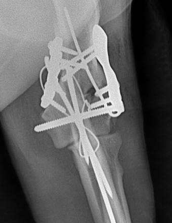

# Estágio na clínica veterinária Mundo Animal: informações reunidas

Este documento reúne tudo o que existe sobre o estágio. As fontes são:

1. **A exportação do projeto do claude.ai** (`estagio-claude-code.zip`, enviado por e-mail em 16/11/2026). Ela traz o diário dia a dia, os exames, as pessoas, o resumo das conversas e as pendências. Os arquivos originais estão em [`exportacao-claude/`](exportacao-claude/).
2. **As 8 páginas publicadas no Claude** (artifacts): 5 da Katita, 2 da criocirurgia e o Microscópio do Estágio. Delas saíram as etapas detalhadas da cirurgia e as 3 radiografias da pasta [`imagens/`](imagens/).
3. **O modelo de slides** "Defesa de Estágio Técnico" do IFC.

Ficaram de fora porque **não vieram na exportação**: as fotos do estágio, os laudos e raios-X em PDF, as defesas de referência (Yasmin e outro colega) e o arquivo `13_11_2026.glb`. A lista completa está em [`exportacao-claude/anexos/LEIAME.md`](exportacao-claude/anexos/LEIAME.md). Esses arquivos precisam ser baixados à mão das conversas.

> **Privacidade:** os laudos e raios-X trazem nomes de tutores e pacientes nos cabeçalhos. Cubra esses nomes antes de usar em slides e corte rostos e telas de celular das fotos.

---

## 1. Identificação

| Campo | Informação |
|---|---|
| Estagiário | Felipe |
| Curso | Técnico em Agropecuária Integrado ao Ensino Médio, IFC Campus Santa Rosa do Sul |
| Orientadora (IFC) | Fran Oliveira |
| Local | Clínica veterinária Mundo Animal, Sombrio (SC) |
| Supervisora no local | Cláudia, veterinária geral |
| Também acompanhado | Thiago, ortopedista da clínica |
| Período | 28/10/2026 a 07/12/2026 |
| Horário | 08:00–13:00 e 13:00–18:00 (no mesmo dia) |
| Defesa | 25 a 30 minutos, formato livre desde que tenha o básico (local do estágio etc.) |
| Referência | Defesa da colega Yasmin, feita na mesma clínica no ano anterior (29 slides) |

**Ainda faltam para o modelo do IFC:** dados formais da clínica (responsável legal, endereço, bairro, CEP, telefone, site), carga horária semanal e total, setor do estágio, área de formação da supervisora, dificuldades encontradas, considerações finais e referências bibliográficas.

---

## 2. Reflexões

Estas são as suas reflexões, com as suas palavras sempre que estavam registradas assim:

- **Sobre a profissão (dia 01):** o trabalho do veterinário é quase mais com humanos do que com animais. Envolve aspectos emocionais e "ultrapessoais" com animais de companhia, mais próximo de uma atividade espiritual, como São Francisco, do que de um simples "tratador".
- **Dia 02:** "Os animais têm uma alma muito pura."
- **O gato de rua (dia 02):** você nunca teve gato e sentia apatia por eles. Começou a se envolver nesse dia: colocava os dedos sob o vidro da baia e o gato se esfregava.
- **A rotina (dia 02):** você pulou o almoço para acompanhar a cirurgia da Katita, querendo sentir o estresse da rotina. O veterinário brincou que depois dessa ele desistiria da veterinária.
- **O papel do anestesista (dia 02):** garantir a sobrevivência da cachorra.
- **Os gatos na clínica (10–11/11):** quase sempre são casos de FIV/FeLV ou cistite. A exceção foi a esporotricose.
- **Tese sugerida numa conversa:** "O paciente é o animal, mas a clínica é construída com as pessoas que o amam."
- **O sentido da defesa:** você quer usar a defesa para explorar a sua curiosidade e as suas "megalomanias", pensando primeiro no sentido dela ("metafísica da defesa") antes de fechar o formato. O que mais agradou ao ortopedista e a quem assistiu foi a animação da cirurgia da Katita.

**Eixos temáticos propostos (nenhum decidido):**
1. Tornar visível o oculto
2. Dar voz ao paciente que não fala
3. Caráter formado por exposição e habituação
4. Mortalidade e tempo condensados em dados clínicos
5. Mídia visual como argumento, não como decoração

---

## 3. Diário do estágio

### Dia 01 — 28/10/2026
- Ao chegar, já havia uma pastora alemã morta.
- Golden retriever com problema respiratório morreu durante o ultrassom (falência múltipla), com a família presente.
- Salsicha com ultrassom mostrando massa no fígado, duas massas no baço e massa nas mamas.
- **Eutanásia** de cão idoso sem qualidade de vida, depois de uma longa conversa com a dona. Feita com cloreto de potássio por via intravenosa, com muito choro.
- Pug com doença renal crônica.
- Gato com lesão na pata: **esporotricose**.
- Procedimento odontológico em cão sob anestesia.
- Vacinas (Vanguard Plus, Nobivac Raiva), antiparasitário Defenza, teste rápido FeLV/FIV.
- Hemograma e bioquímico da pastora alemã (ver seção 5).
- Equipamentos vistos: analisador VetScan VS2, microscópio, duas geladeiras (cadeia fria), balança e armário de farmácia. O disco de reagente da foto é o "rotor" do exame de sangue.
- Ideia do dia: juntar todos os exames de sangue e fazer algo visual com eles.

### Dia 02 — 29/10/2026
- **Cirurgia da Katita** (ver seção 4.1).
- **Bob**, pinscher de 13 anos, em consulta com o Thiago (ver seção 4.2).
- Gato de rua branco internado, resgatado de uma organização: vômito, muitas pulgas, fezes pastosas e fedidas. Tratamento: antibiótico, vermífugo, antipulgas e dexametasona. Não foi feito teste de FeLV.
- Shih-tzu de 17 anos e 6 meses recebendo soro e suplemento intravenoso 3 vezes por semana.
- Fotos: campo cirúrgico e equipe, aparelho de raio-X e notebook com o software.

### Dia 03 — 30/10/2026
- Fotos dos raios-X: pós-operatório do cotovelo da Katita (3 incidências), Bob (31/08/2026, 3 incidências) e pelve/quadril da Luna (29/10).
- **Luna:** atropelada, com aparente fratura de quadril (não confirmada). Recebeu meloxicam, metadona e dipirona. A conduta não ficou registrada.
- Seringas preparadas: (1) antibiótico, meloxicam, dipirona e metadona; (2) amoxicilina, dexametasona e dipirona.
- **Atena:** filhote fêmea caramelo, resgatada por um tutor educado que trabalha no fórum. Ele perguntou sobre quantidade de comida, brinquedos, cuidados, apartamento e corrida. Ela foi vacinada e teve exame de sangue pedido.

### Dia 04 — 03/11/2026
- Você recebeu o PDF da defesa da Yasmin: 29 slides com identificação, histórico da clínica, infraestrutura, procedimentos, casos, exames e considerações. A dela era descritiva. A sua pode apostar em casos narrativos (Katita, Bob) e numa reflexão final.
- Surgiu a ideia de uma animação simples explicando a cirurgia da Katita.

### Dia 05 — 04/11/2026
- **Barão:** linfoma na raiz dentária. Cerca de 8 dentes extraídos, com fotos de antes e depois. Exames na seção 5.
- Cachorro com 6 dedos (**polidactilia**).
- Várias vacinas V8/V10 e antirrábica aplicadas, sem contagem.
- A animação 2D da Katita foi ajustada com detalhes das fotos reais: campo cirúrgico azul, mesa com tecido de estampa de onça, tubo de anestesia branco, cirurgião, anestesista, cilindro de oxigênio, suporte de soro e monitor.

### Dia 06 — 05/11/2026
- **Criocirurgia de melanoma** na região do traseiro (ver seção 4.4).
- **Mel Serafina**, gata com anemia forte e provável FeLV (ver seção 4.6).
- **Nodulectomia** na pálpebra superior de uma cachorra: bisturi e hemostasia com ferro quente (cauterização).

### Dia 07 — 06/11/2026
- Ultrassom em **gato paraplégico**: macho não castrado de 2 anos, jogado de uma janela em movimento quando filhote. A tutora esvazia a bexiga dele manualmente. O ultrassom mostrou cristais na bexiga.
- Cadela de 12 anos com mordida superficial no pescoço: limpeza, clorexidina degermante e curativo. Não foi suturada porque a sutura poderia formar abscesso. Dipirona em gotas se doer.
- **Transfusão de sangue na Mel Serafina**, com fotos da bolsa e do equipo.
- **Mel, labradora:** laudo de biópsia com hemangiossarcoma esplênico (ver seção 4.5).
- Faltavam 5 semanas de estágio.

### 09/11/2026 (segunda)
- **Cinomose:** a Cláudia não atendia nenhum caso havia 1 ano, pela eficácia da vacinação. Orientou você a trocar de roupa e tomar banho antes de ver o seu cachorro.
- **Parvovirose:** no ano passado a Cláudia atendia casos toda semana. Hoje a clínica não tem casos. Vale pedir números concretos.
- Site recomendado: **vetsapiens**, plataforma brasileira para veterinários. Parte do conteúdo pode exigir CRMV.

### 10/11 e 11/11/2026
- **10/11:** ultrassom em gato com suspeita urinária, com diagnóstico de cistite.
- **11/11 (quarta):** um dobermann agitado não deixou fazer o ultrassom. A dona recusou sedação e saiu muito alterada.
- **11/11:** banho e tosa. A sequência da Cláudia: shampoo verde, shampoo azul, condicionador e secagem com soprador.
- **11/11, castração (ovariohisterectomia) de uma cadela:** você segurou o útero com pinça na mão esquerda para a Cláudia cortar e suturar, e pressionou uma parte durante a sutura. Não houve hemorragia nem cauterização.
  - **Como apresentar na defesa:** como auxílio sob supervisão. Incisão, ligadura e sutura são atos privativos do veterinário (Lei 5.517/68 e Lei 11.788/2008). Confirmar com a Fran.

### 12/11/2026 (quinta)
- **Quimioterapia** (ver seção 4.3).
- **Cistocentese ecoguiada** em cão com suspeita de doença renal: o ultrassom é usado antes de puxar a urina. Pedir a densidade urinária e os valores de ureia e creatinina.

### 13/11/2026
- Você enviou o modelo 3D do esqueleto de cachorro (`.glb`) e pediu a cirurgia da Katita sobre ele. A versão foi publicada.
- Você não gostou das primeiras ideias interativas e escolheu prototipar a "Katita modo cinema".

---

## 4. Casos em detalhe

### 4.1 Katita: fratura em Y do cotovelo (29/10/2026)

| | |
|---|---|
| Paciente | Katita, cadela SRD, 7 anos, 35 kg |
| Causa | Atropelamento |
| Lesão | Fratura em Y na extremidade do úmero (úmero distal), junto ao cotovelo |
| Cirurgião | Thiago (ortopedista) |
| Duração | Mais de 4 horas |

**O que você anotou na hora:**
- **Acesso:** osteotomia do olécrano, para alcançar o outro lado do cotovelo "para não precisar cortar mais".
- **Fixação:** 2 placas, parafuso intercondilar e banda de tensão com pino.
- **Fechamento:** músculo com fio absorvível e pele com nylon.
- **Raio-X pós-operatório:** as placas unem os ossos rachados, o parafuso transversal embaixo une os dois ossos e os demais parafusos dão fixação.

**Etapas detalhadas (da página "no esqueleto 3D"):**

| # | Etapa | Estruturas | Objetivo | Instrumentos |
|---|---|---|---|---|
| 1 | Esqueleto e cotovelo | Escápula, úmero, rádio, ulna, olécrano (membro anterior esquerdo) | Localizar a região operada | — |
| 2 | Lesão em Y | Diáfise do úmero, côndilos lateral e medial | Reconhecer a fratura em três partes | Radiografia |
| 3 | Osteotomia do olécrano | Olécrano, ulna proximal, tríceps braquial | Expor a articulação | Afastadores de Hohmann, serra oscilatória |
| 4 | Redução e parafuso | Côndilos medial e lateral | Recompor a superfície articular e comprimir os fragmentos | Pinça de redução, furadeira, parafuso de compressão |
| 5 | Placas e parafusos | Úmero distal, faces lateral e medial, canal medular | Fixar os côndilos ao corpo do úmero | Placas, furadeira, parafusos corticais, pino intramedular |
| 6 | Banda de tensão | Olécrano, ulna | Refixar o olécrano, transformando a tração do tríceps em compressão | Furadeira, pinos de Kirschner, fio de cerclagem |
| 7 | Fechamento | Músculo, subcutâneo, pele | Reconstruir os planos e proteger a fixação | Porta-agulhas, fio absorvível, nylon |

**Radiografias:**

| Imagem 1 (marcada como pré-operatória na página) | Pós-operatório (DP) | Pós-operatório (lateral) |
|---|---|---|
|  |  |  |

**A confirmar com o Thiago:**
- **Lado operado.** A página 3D diz esquerdo, mas o diário marca como não confirmado.
- **Duração, anestesia e pós-operatório.**
- **Parafuso:** "intercondilar" (diário) ou "transcondilar" (página 3D).
- **Pinos:** o diário diz "banda de tensão com pino", no singular. A página 3D mostra pino intramedular no úmero, 2 pinos longos na ulna e 1 pino transversal. Esses detalhes vieram da leitura da radiografia.
- **Radiografia pré-operatória:** o diário só cita fotos do raio-X pós-operatório (3 incidências). Confirmar de onde veio a imagem marcada como pré-operatória.
- **PDFs do raio-X pós-operatório:** ainda precisam ser pedidos à clínica.

### 4.2 Bob: claudicação neurológica (29/10/2026)
- **Paciente:** pinscher de 13 anos.
- **Queixa:** não apoia a pata há 2 meses. Quebrou essa mesma pata aos 4 meses de idade.
- A Cláudia não chegou a um diagnóstico e encaminhou ao **Thiago**.
- **Exame:** anda com 3 patas. No teste de encostar a pata na mesa, reage normalmente com os olhos livres e não reage com os olhos tapados.
- **Conclusão:** problema **neurológico**, sem indicação de cirurgia. A pata já está um pouco atrofiada. Foi recomendada **bota ortopédica**. Há risco de automutilação se ele não sente a pata.
- **Radiografia de 31/08/2026:** lesão antiga já calcificada, que segundo o Thiago não explica a claudicação.
- **Pendente:** pedir a radiografia à clínica.

### 4.3 Quimioterapia com doxorrubicina (12/11/2026)
- **Paciente:** cão de 17 anos com **sarcoma** no pescoço e na cabeça. Está em tratamento com oncologista há 7 meses.
- **Medicamento:** doxorrubicina (Fauldoxo, Libbs, 50 mg/25 mL, uso exclusivamente intravenoso). É um fármaco **vesicante**, que lesa o tecido se extravasar.
- **Frequência:** a cada 21 dias.
- **Dose:** uma seringa cheia. Você ouviu "6,4/2 que dá 3,2". As unidades **não estão confirmadas**.
- **Aplicação:** feita em seringa, e não em bolsa, porque o cão arranca o acesso mordendo.
- **Paramentação:** avental descartável, respirador com filtro e protetor facial. O cão usava focinheira.
- **Soro:** havia uma bolsa de NaCl 0,9% 250 mL, provavelmente para lavar o acesso (confirmar).

### 4.4 Criocirurgia de melanoma (05/11/2026)
- Lesão na pele, na **região do traseiro** do cão.
- O tutor foi avisado de que o local vai inchar, sangrar um pouco e a lesão vai cair. Se doer, dar dipirona em gotas.

**Passo a passo (das páginas animadas):**
1. **Lesão:** escura e pequena, em área tosada. Os melanócitos acumulam pigmento.
2. **Nitrogênio líquido em spray**, a cerca de −196 °C. O gelo rompe as membranas das células e fecha os vasos que alimentam o tumor.
3. **Inchaço** depois do degelo. É a inflamação, e é esperado.
4. **Sangramento leve:** os vasos danificados extravasam sangue e plasma.
5. **Dipirona em gotas** se houver dor, na dose definida pelo veterinário conforme o peso.
6. **A lesão cai:** escurece, seca, forma crosta e se solta em algumas semanas, com pele nova por baixo.
7. **Recuperação:** técnica pouco invasiva, e o animal volta à rotina.

**Melanoma em cães:** é um tumor de melanócitos. Os da pele (melanocitomas) são na maioria benignos. Os da boca e do leito das unhas são os mais agressivos. A confirmação vem por citologia ou histopatologia.

### 4.5 Mel, labradora: hemangiossarcoma esplênico
- **Paciente:** labradora de cerca de 13 anos (nascida em 06/03/2014 pelo laudo), fêmea castrada. Tutora: Angela. **Não é a mesma Mel da gata Mel Serafina.**
- **07/10/2026:** hemograma no Labvet Sul (pedido pela Cláudia) já mostrava anemia e plaquetas baixas.
- **Ultrassom de 07/10/2026** (Nexavet, Hillary Giordani; mucosas pálidas, apática):
  - Fígado discretamente aumentado e hiperecogênico.
  - Vesícula com repleção moderada e discreto sedimento.
  - Baço aumentado, com várias estruturas arredondadas hipoecogênicas. A maior tem 4,45 × 4,13 cm e uma delas tem irregularidade de cápsula.
  - Rins sem alterações.
  - Adrenal esquerda aumentada, com nódulo de 1,96 × 1,40 cm no polo cranial. Adrenal direita não caracterizada.
- **Esplenectomia total.**
- **Biópsia** (Labvet Sul, coletada em 08/10/2026, laudo de 27/10/2026):
  - Massa na extremidade cranial do baço, com ruptura.
  - Peça de 22,5 × 6,8 × 3,0 cm. Ruptura de 3,2 × 3,0 cm.
  - **Diagnóstico: hemangiossarcoma esplênico** com ruptura e hematoma, hemossiderose e megacariócitos.
  - 22 mitoses em 2,37 mm². Hemorragia prévia crônica e hematopoese extramedular.
- **Evolução:** do pós-cirúrgico (16/10) até 06/11, a hemoglobina, o hematócrito, as plaquetas e os leucócitos caíram. Em 06/11 o hematócrito estava em 13,88%, o mais baixo da série.

### 4.6 Mel Serafina: anemia grave, provável FeLV (05 e 06/11/2026)
- **Paciente:** gata SRD, fêmea castrada, nascida em 09/04/2020.
- **Quadro:** mucosas muito brancas e dificuldade para ficar de pé. O sangue do pescoço estava muito escuro, por falta de oxigênio.
- Os donos consideraram eutanásia, mas antes optaram pela **transfusão**, feita em 06/11. Se o quadro se repetir em 3 dias, a recomendação é a eutanásia.

### 4.7 Barão: linfoma na raiz dentária (04/11/2026)
- **Paciente:** SRD, macho castrado, nascido em 08/04/2015.
- Cerca de 8 dentes extraídos, com fotos de antes e depois.
- O hemograma mostrou leucocitose com linfócitos e monócitos altos e plaquetas baixas.

### 4.8 Outros casos e procedimentos
| Data | Caso |
|---|---|
| 28/10 | Óbito de golden retriever no ultrassom; salsicha com massas no fígado, baço e mamas; eutanásia de cão idoso; pug com doença renal crônica; gato com esporotricose; odontologia |
| 29/10 | Gato de rua internado; shih-tzu de 17 anos com soro 3x por semana |
| 30/10 | Luna (atropelada, possível fratura de quadril); Atena (filhote, vacinas e exame de sangue) |
| 04/11 | Cão com polidactilia; vacinas V8/V10 e antirrábica |
| 05/11 | Nodulectomia na pálpebra com cauterização |
| 06/11 | Gato paraplégico com cristais na bexiga; cadela com mordida no pescoço |
| 10/11 | Gato com cistite (ultrassom) |
| 11/11 | Dobermann sem ultrassom (recusa de sedação); banho e tosa; castração |
| 12/11 | Cistocentese ecoguiada |

---

## 5. Exames de sangue

As unidades estão como no laudo do analisador. A referência vem entre parênteses.

### Pastora alemã (fêmea castrada, nascida em 2020) — 28/10/2026
**Hemograma (17:56):**
- **Leucócitos:** leucócitos 20,11 (6,0–17,0) ↑; linfócitos 2,18 (1,0–4,8); monócitos 0,36 (0,2–1,5); neutrófilos 15,83 (3,0–12,0) ↑; eosinófilos 1,43 (0,0–0,8) ↑; basófilos 0,30 (0,0–0,4).
- **Diferencial (%):** linfócitos 10,9; monócitos 1,8; neutrófilos 78,7; eosinófilos 7,1; basófilos 1,5.
- **Série vermelha:** eritrócitos 7,25 (5,5–8,5); hemoglobina 21,3 (12,0–18,0) ↑; hematócrito 48,95 (37,0–55,0); VCM 68 (60–77); HCM 29,3 (19,5–24,5) ↑; CHCM 43,4 (31,0–39,0) ↑; RDWc 21,0 (14,0–20,0) ↑; RDWs 41,4.
- **Plaquetas:** 322 (165–500); VPM 10,7 (3,9–11,1); PCT 0,35; PDWc 38,3; PDWs 16,1.

**Bioquímico (Prep Profile II, 17:59):** ALP 67 (20–150); ALT 45 (10–118); BUN 11 (7–25); creatinina 0,7 (0,3–1,4); glicose 118 (60–110) ↑; proteínas totais 9,0 ↑. Hemólise 3+, lipemia 3+, icterícia 0.

### Barão (SRD, macho castrado, nascido em 08/04/2015) — 04/11/2026
**Hemograma (08:30, laudo com aviso "ATENÇÃO"):**
- **Leucócitos:** leucócitos 23,60 ↑; linfócitos 5,97 ↑; monócitos 2,14 ↑; neutrófilos 15,30 ↑; eosinófilos 0,16; basófilos 0,03.
- **Diferencial (%):** linfócitos 25,3; monócitos 9,1; neutrófilos 64,8; eosinófilos 0,7; basófilos 0,1.
- **Série vermelha:** eritrócitos 6,43; hemoglobina 18,5 ↑; hematócrito 44,61; VCM 69; HCM 28,8 ↑; CHCM 41,5 ↑; RDWc 21,3 ↑; RDWs 43,8.
- **Plaquetas:** 121 (165–500) ↓; VPM 10,2; PCT 0,12; PDWc 40,3; PDWs 19,2.

**Bioquímico (08:28):** ALP 148 (20–150); ALT 69; BUN 14; creatinina 0,7; glicose 109; proteínas totais 7,6 (5,4–8,2). Hemólise 3+, lipemia 3+, icterícia 0.

### Mel Serafina (gata) — 05/11/2026
As referências estão ilegíveis na foto.

**Hemograma (13:12):**
- **Leucócitos:** leucócitos 17,02; linfócitos 0,34 ↓; monócitos 0,47; neutrófilos 16,03 ↑; eosinófilos 0,19; basófilos 0,00.
- **Diferencial (%):** linfócitos 2,0; monócitos 2,7; neutrófilos 94,2; eosinófilos 1,1; basófilos 0,0.
- **Série vermelha:** eritrócitos 3,17 ↓; hemoglobina 6,3 ↓; hematócrito 19,42 ↓; VCM 61 ↑; HCM 19,9 ↑; CHCM 32,5; RDWc 26,9 ↑; RDWs 49,2.
- **Plaquetas:** 38 ↓; VPM 13,7; PCT 0,05; PDWc 43,4; PDWs 25,7.

**Bioquímico (13:16):** ALP 34; ALT 55; BUN 16; creatinina 0,8; glicose 197 ↑; proteínas totais 6,7. Hemólise 3+, lipemia 0, icterícia 0.

### Mel (labradora)
**07/10/2026 (Labvet Sul):**
- **Série vermelha:** hemácias 3,73 (5,5–8,5); hematócrito 24% (37–55); hemoglobina 7,1 (12–18); VGM 64,34; CHGM 29,58 (32–36); RDW 14,5; PPT 5,4 (6,0–8,0).
- **Plaquetas:** 87.000 (200.000–500.000).
- **Leucócitos:** 17.000. Segmentados 93% (15.810/µL; ref. 3.000–11.500), linfócitos 3% (510), monócitos 4% (680).
- **Observações:** macroplaquetas + e monócitos ativados +. Sem hemoparasitas.
- **Bioquímico:** ALT 136 (10–86) ↑; AST 38; creatinina 0,70; fosfatase alcalina 426 (20–155) ↑; glicose 103; proteínas totais 5,00 (5,8–7,9) ↓; albumina 2,70; globulina 2,30 (2,6–5,1) ↓; relação A/G 1,17; ureia 28,3.

**16/10/2026, 11:10 (analisador Zoetis):** leucócitos 34,69 ↑; neutrófilos 28,11 ↑; linfócitos 3,98; monócitos 2,47 ↑; hemoglobina 8,2 ↓; hematócrito 21,24 ↓; VCM 76; HCM 29,4 ↑; CHCM 38,6; RDWc 30,6 ↑; plaquetas 403; VPM 10,9; eritrócitos 2,79 ↓.

**06/11/2026, 13:42 (Zoetis):** leucócitos 15,15; neutrófilos 12,19 ↑; linfócitos 2,38; monócitos 0,53; hemoglobina 4,9 ↓; hematócrito 13,88 ↓; VCM 63; HCM 22,3; CHCM 35,6; RDWc 25,4 ↑; plaquetas 102 ↓; VPM 11,4 ↑; eritrócitos 2,22 ↓.

**Para levar à Cláudia:** na pastora alemã e no Barão, a hemoglobina e o CHCM estão altos com hematócrito normal. Isso pode ser interferência da hemólise e da lipemia 3+. Confirmar.

---

## 6. Medicamentos, vacinas e equipamentos citados

| Tipo | Itens |
|---|---|
| Analgésicos e anti-inflamatórios | Dipirona (injetável e em gotas), meloxicam, metadona, dexametasona |
| Antibióticos | Amoxicilina e "antibiótico" não especificado |
| Quimioterápico | Doxorrubicina (Fauldoxo, Libbs, 50 mg/25 mL) |
| Eutanásia | Cloreto de potássio intravenoso |
| Antissépticos | Clorexidina degermante |
| Fluidos | NaCl 0,9% 250 mL; soro e suplemento intravenoso |
| Vacinas | Vanguard Plus, V8/V10, Nobivac Raiva (antirrábica) |
| Antiparasitários | Defenza, vermífugo, antipulgas |
| Testes rápidos | FeLV/FIV |
| Equipamentos | Analisador hematológico VetScan VS2 (com rotor de reagente) e analisador Zoetis, microscópio, ultrassom, raio-X com notebook e software, 2 geladeiras (cadeia fria), balança, armário de farmácia, cauterizador (ferro quente), monitor, cilindro de oxigênio, suporte de soro |
| Laboratórios externos | Labvet Sul (hemograma e biópsia), Nexavet (ultrassom) |

---

## 7. Pessoas

| Pessoa | Papel |
|---|---|
| Cláudia | Veterinária geral, supervisora no estágio |
| Thiago | Ortopedista; cirurgião da Katita e responsável pelo caso do Bob |
| Fran Oliveira | Orientadora do estágio no IFC |
| Yasmin | Colega que defendeu estágio na mesma clínica no ano passado |
| Angela | Tutora da labradora Mel |
| Hillary Giordani | Responsável pelo ultrassom da Mel (Nexavet) |

---

## 8. Páginas e animações já feitas

| Peça | Link |
|---|---|
| Animação 2D da cirurgia da Katita (com a cena da sala) | https://claude.ai/artifact/Au4qBLBJmnheLzDqEfjwHu |
| Cirurgia da Katita em 3D (osso em Y e visão do cirurgião) | https://claude.ai/artifact/5jzyf4bCynjkN2e3FroFAk |
| Katita · esqueleto (Sketchfab e esquema) | https://claude.ai/artifact/7T8s51Mbg1CVfJv3QmdYpF |
| Katita — modo cinema (44 s) | https://claude.ai/artifact/GHahiDvJjzuTiSw8xbjt3c |
| Cirurgia da Katita no esqueleto 3D (versão mais completa, com raios-X) | https://claude.ai/artifact/HzsxC8rvK49Ss3tfd1b76K |
| Criocirurgia do melanoma (2D) | https://claude.ai/artifact/S3VwYSQPFshNejM9JrGvDv |
| Criocirurgia do melanoma (3D) | https://claude.ai/artifact/UMCerhq34d46XxXLvPbmq7 |
| Microscópio do Estágio | https://claude.ai/artifact/85brKfCJS7kMSgTEgs4NYZ |

**O que aprendemos sobre o visual:**
- Formas geométricas simples ("esferas e cilindros") não impressionam.
- O que funcionou foi material real: raio-X, fotos e o modelo 3D do esqueleto.
- Recursos genéricos (quiz, slider, painel, QR code, assistente) foram rejeitados.
- Ter um **plano B offline** (PDF ou vídeo), porque as páginas dependem de internet.

**Ideias em aberto:**
- "Katita modo cinema" com raio-X real: cortina de antes e depois, o Y desenhado em vermelho, os implantes acendendo e fotos reais da cirurgia.
- Animação da limpeza de tártaro e extração dentária (pedida, ainda não feita).
- Linha do tempo dos exames da Mel e um corpo com os órgãos acesos para mostrar a bioquímica.

---

## 9. Pendências

**Pedir à clínica:**
- [ ] Exame de sangue do gato de rua (à Cláudia)
- [ ] Radiografia do Bob
- [ ] PDFs do raio-X pós-operatório da Katita
- [ ] Números de casos de parvovirose do ano passado e de agora
- [ ] Densidade urinária, ureia e creatinina do cão da cistocentese

**Confirmar:**
- [ ] Com o Thiago: detalhes da cirurgia da Katita (duração, anestesia, pós-operatório, lado operado, parafuso e pinos)
- [ ] Unidades da dose de doxorrubicina ("6,4/2 que dá 3,2")
- [ ] Para que servia a bolsa de NaCl 0,9% na quimioterapia
- [ ] Com a Cláudia: hemoglobina e CHCM altos na pastora alemã e no Barão
- [ ] Com a Fran: como apresentar a participação na castração de 11/11

**Organizar:**
- [ ] Começar a contar as vacinas aplicadas por dia
- [ ] Baixar das conversas do claude.ai as fotos, os laudos, os PDFs de referência e o `.glb`
- [ ] Cobrir nomes de tutores e pacientes nos laudos e raios-X antes de usar nos slides
- [ ] Registrar os dias depois de 13/11 (o estágio vai até 07/12)
